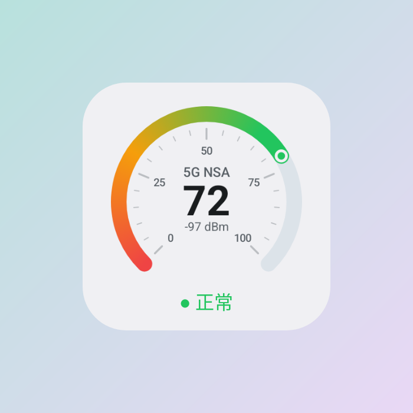
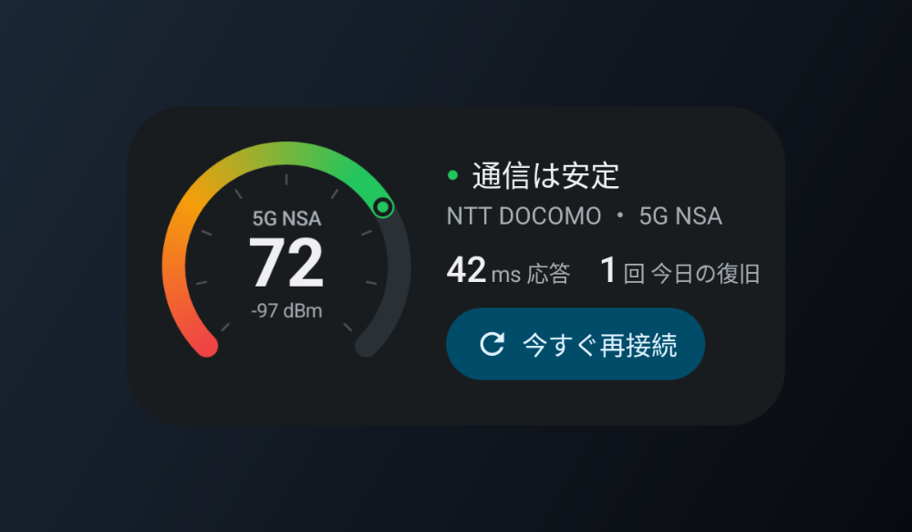

# ReConnect — パケ止まりを見張って、自動で回線を入れ直す

「アンテナは立っているのに通信できない」「電波が悪くなったまま戻らない」。
そんな状態を **ReConnect** が見つけて、モバイル回線を自動で**つなぎ直し**ます。
電波の強さはアプリとホーム画面ウィジェットの**メーター**でひと目でわかります。

<p>


</p>
<p>

</p>

### ホーム画面ウィジェット「電波メーター」

<p>


</p>

- **2×2**：電波品質メーター（0〜100）と状態
- **横に広げる**：状態・通信会社・応答速度・今日の復旧回数・**「今すぐ再接続」ボタン**
- Android 12 以降は壁紙の色（Material You）に、ダークモードにも自動で合わせます
- 監視をオフにしていても、メーターは電波を表示します

## できること

| | |
|---|---|
| 🛰 **パケ止まりの検知** | モバイル回線経由で `generate_204` に小さな通信を送り、届かない状態が続いたら異常と判断 |
| 🔁 **自動で再接続** | ① モバイルデータ OFF→ON → ② だめなら機内モード ON→OFF |
| 🧯 **やりすぎ防止** | 再接続後は待ち時間を入れ、失敗するたびに倍々に延長（最大30分）。1時間あたりの回数にも上限。途中で止めても無線を切ったままにしない |
| 📈 **電波品質の推移** | 直近1時間の推移グラフに、疎通NG（赤い点）と再接続（青い破線）を表示。アプリを閉じても残ります |
| 🗂 **履歴と統計** | 今日の再接続回数・成功率・異常検知・正常率、日ごとのタイムライン |
| ⚙️ **細かな設定** | チェック間隔、判定回数、電波が弱いときも再接続（RSRP 閾値）、待ち時間、上限 |
| 🔔 **通知とタイル** | 通知から「今すぐ再接続」「停止」、再接続中は進捗バー。クイック設定タイルで監視の ON/OFF |
| ✨ **気持ちよい動き** | 値はばねアニメーションで動き、再接続中は弧の上を光が走り、復旧すると緑の波紋が広がる |
| 👆 **触れるグラフ** | 推移グラフを指でなぞると、その時刻の品質・RSRP・応答速度を吹き出しで表示 |
| 🧭 **迷わない導線** | 初回の案内（メーターのデモつき）、準備のチェックリスト、ウィジェットやタイルをアプリから追加、Shizuku が無いときの案内 |
| 📱 **どの画面でも** | タブレット・横向きは2列＋ナビゲーションレール。文字サイズを大きくしても崩れない |
| ♿ **使いやすさ** | ダークモード、Material You、メーターやグラフに読み上げ用の説明、見出しの指定、触覚フィードバック |

Wi-Fi・機内モード・モバイルデータ OFF の間は、監視を自動で休みます。

## 必要なもの

Android 10 以上。普通のアプリには機内モードやモバイルデータを切り替える権限がないため、次のどちらかが必要です。

- **[Shizuku](https://shizuku.rikka.app/)**（おすすめ・root 不要）— Android 11 以降なら「ワイヤレスデバッグ」で端末だけで起動できます。端末を再起動したら Shizuku の「開始」をもう一度押してください。
- **root**（Shizuku が使えないときは `su` で実行します）

## はじめかた

1. Shizuku をインストールして起動します（Shizuku アプリの案内に沿ってワイヤレスデバッグでペアリング → 開始）。
2. ReConnect の APK をインストールします。
   - GitHub の **Actions** → 最新の「Build APK」→ Artifacts の `ReConnect-apk`
   - または `v1.0.0` などのタグを push すると **Releases** に APK が添付されます
3. 最初の案内のあと、ホームに出る「**はじめに**」の 3 ステップを済ませます（Shizuku・通知と電話の状態・電池の最適化）。
4. Wi-Fi をオフにして「**今すぐ再接続**」を押し、モバイルデータが一瞬切れて戻ることを確かめます。
5. 「**自動再接続**」をオンにすれば完了です。ホームの案内カード（または 設定 → 便利な機能）から「電波メーター」ウィジェットを置けます。

## 開発

```sh
./gradlew assembleRelease        # R8 で最適化した APK（約2MB）
./gradlew assembleDebug          # デバッグ版
./gradlew recordPaparazziDebug   # 画面とウィジェットのスクリーンショットを撮り直す（端末不要）
```

- UI は Jetpack Compose + Material 3。ウィジェットは RemoteViews で、メーターは Canvas でビットマップに描いています（アプリ内のメーターと同じデザイン）。
- `app/debug.keystore` は、CI とローカルのどちらでビルドしても同じ署名にして上書きインストールできるようにするための鍵です（秘密の鍵ではありません）。

```
app/src/main/java/io/github/snowiris57/reconnect/
├── MainActivity.kt         Compose 画面の入口・権限の要求
├── MonitorService.kt       常駐監視・判定・再接続の手順・やりすぎ防止
├── NetCheck.kt             電波（RSRP / 品質 / 方式 / 通信会社）と疎通確認
├── MonitorState.kt         状態・計測サンプル・イベント履歴・統計
├── Shell.kt / ShellService.kt  Shizuku UserService（または su）で特権コマンドを実行
├── MonitorTileService.kt   クイック設定タイル
├── BootReceiver.kt         起動時の自動開始
├── Prefs.kt                設定
├── widget/                 電波メーターのウィジェット（MeterWidget / GaugeBitmap）
└── ui/                     テーマ・メーター・グラフ・ホーム / 履歴 / 設定画面
```

## 参考にしたプロジェクト

- [R-Dilipkumar/one-tap-network-reset](https://github.com/R-Dilipkumar/one-tap-network-reset) — Shizuku/root でモバイル回線をリセット
- [lalakii/android_airplane_mode](https://github.com/lalakii/android_airplane_mode) — Shizuku で機内モードを切り替え
- [aunchagaonkar/NetworkSwitch](https://github.com/aunchagaonkar/NetworkSwitch) — Shizuku 連携
- [ishara-madu/4GLTEOnlyApp](https://github.com/ishara-madu/4GLTEOnlyApp) — 電波指標の監視
